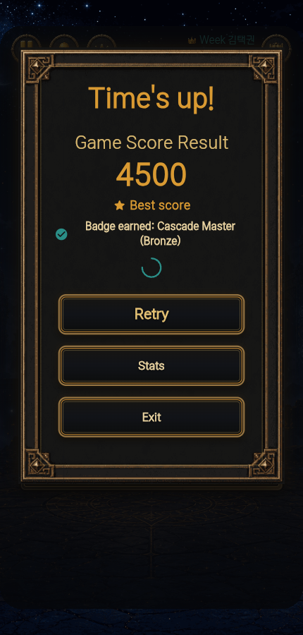
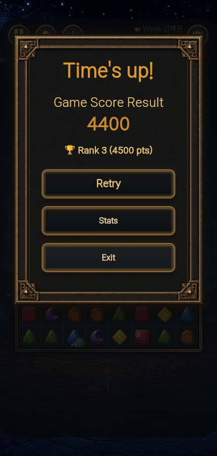

# Flame 플레이 봇 자료

정리일: 2026-10-08. 현재 코드 대조 기준: `c1221b6`.

Stone Match의 Flutter/Flame 타임 모드를 실제 포인터로 플레이하는 자동화 자료다. 실행 코드는 기존 `tools/`를 사용한다. 외부 폴더의 자료를 대조해 실행 안내, 코드 위치, 과거 검증 근거를 연결했다. 이번 작업에서 게임이나 봇 코드는 변경하지 않았다.

## 읽는 순서

1. [실행 안내와 옵션](../../../tools/PLAY_BOT.md): 준비, 대상 URL, 에고 실행, 성공 기준과 실패 대응.
2. [기술 명세](../../03_TECH_SPEC.md): 화면 인식, 입력과 점수 판정 계약.
3. [개발 워크플로](../../04_DEVELOPMENT_WORKFLOW.md): 자동화 요청 시 수행 범위.
4. 아래 검증 기록과 [원본 파일 대조 목록](SOURCE_MANIFEST.json): 무엇을 실제로 확인했고 어떤 근거가 남아 있는지.

## 코드 위치와 역할

| 파일 | 역할 |
|---|---|
| [play_bot_vision.mjs](../../../tools/play_bot_vision.mjs) | 390×750 기준 좌표, 8×8 보석 색 인식, 인접 교환 탐색, 최종 점수 안정화 |
| [play_bot.mjs](../../../tools/play_bot.mjs) | 별도 브라우저 실행, QA 읽기 브리지 또는 화면 인식, 1~2판, GA4 응답 관찰 |
| [run_play_bot_ego.mjs](../../../tools/run_play_bot_ego.mjs) | CLI 옵션을 에고 런타임으로 전달 |
| [play_bot_ego.mjs](../../../tools/play_bot_ego.mjs) | 에고 TaskSpace에서 화면 인식과 CDP 포인터 입력, 1판, 동의 상태 기록 |
| [play_bot.test.mjs](../../../tools/play_bot.test.mjs) | 점수 중간값 배제, 유효 교환, 미인식 칸 제외, 6색과 두 화면 크기 테스트 |
| [package.json](../../../package.json) | `play:bot`, `play:bot:ego`, `test:play-bot` 및 의존성 |

화면 보석을 읽는 코드는 게임 상태를 직접 수정하지 않는다. 메뉴는 Flutter 접근성 클릭을 사용하고 보드 교환은 포인터 드래그를 사용한다. QA 경로만 `__jewelMatchGetState`, `__jewelMatchGetHintMove`의 읽기 결과를 이용한다.

## 원본 정리 결과

출처 폴더: `/Users/cheng80/Desktop/referenced-chatgpt-conversation-this-is-an`.

| 원본 | 프로젝트 안의 보존 위치와 처리 |
|---|---|
| `work/play-bot-package/tools/`의 MJS 5개 | 현재 `tools/`와 바이트 및 SHA256 일치. 현재 파일 재사용 |
| `outputs/PLAY_BOT.md`, `work/play-bot-package/tools/PLAY_BOT.md` | 두 원본은 동일. 현재 실행 안내는 의존성 버전 설명을 추가한 후속본이며, 원문은 아래 ZIP의 `tools/PLAY_BOT.md`에 보존 |
| `work/play-bot-package/package.json` | 독립 배포용 최소 구성. 봇 scripts 3개와 의존성 2개는 현재 프로젝트와 일치. 원문은 아래 ZIP의 `package.json`에 보존 |
| `outputs/stone-match-play-bot.zip` | [원본 패키지](evidence/2026-10-01/stone-match-play-bot.zip), 7개 항목이 `work/play-bot-package/`와 모두 일치 |
| `outputs/report.json` | [과거 실행 JSON](evidence/2026-10-01/report.json), 원본 그대로 보존 |
| `outputs/round-1-end.png`, `outputs/round-2-end.png` | 아래 결과 캡처 2장, 원본 그대로 보존 |
| `outputs/검증결과.md` | [당시 검증 기록 원문](evidence/2026-10-01/검증결과.md) |
| `outputs/대시보드-자동로그인-검증.md` | [대시보드 자동 로그인 기록 원문](evidence/2026-10-01/대시보드-자동로그인-검증.md), 관련 프로젝트의 과거 참고 기록 |
| `.DS_Store` 3개 | macOS 폴더 메타데이터로 이관 제외 |

원본 폴더는 변경하지 않았다. ZIP은 역사적 패키지이므로 프로젝트 루트에 덮어 풀거나 최소 `package.json`으로 현재 파일을 교체하지 않는다. ZIP과 원문에 담긴 운영 실행 명령, 배포 완료 또는 로그인 상태 설명은 당시 기록이다. 현재 작업 지시나 현재 세션 상태를 뜻하지 않는다.

`SOURCE_MANIFEST.json`은 원본 14개 파일의 크기, SHA256, 대응 위치와 ZIP 내부 7개 파일의 해시를 기록한다. 이번에 보존한 장기 참고 근거는 이 `evidence/` 아래 두고, 이후 실행에서 생기는 임시 로그와 캡처는 기존대로 `tmp/play-bot/`에 둔다.

## 2026-10-01 검증 기록

| 검증 | 결과 | 근거 종류 | 실행일 | 리비전 | 현재 유효성 | 근거와 한계 |
|---|---|---|---|---|---|---|
| 에고 실제 교환 | PASS | HISTORICAL | 2026-10-01 | UNKNOWN | UNKNOWN | 당시 기록에 8회 시도와 보드 변화 8회. 에고 원시 JSON/캡처는 제공 폴더에 없음 |
| 에고 수정 후 최종 점수 대기 | NOT_RUN | NONE | 해당 없음 | UNKNOWN | UNKNOWN | 최소 3초 대기와 1초 안정화 수정 후 에고 재실행은 하지 않음. 초기 1524점은 중간값으로 제외 |
| 별도 Chromium 운영 2판 | PASS | HISTORICAL | 2026-10-01 | UNKNOWN | UNKNOWN | JSON: 각 8회 시도/검증, 최종 4500/4400, `errors=[]`, `success=true`. 현재 운영 빌드 검증이 아님 |
| 운영 GA4 수집 응답 | PASS | HISTORICAL | 2026-10-01 | UNKNOWN | UNKNOWN | 동의 true, `G-1D8SDVLZQX`의 `page_view`, `level_start`, `level_end` HTTP204. 응답 뒤 `ERR_ABORTED` 기록도 그대로 보존 |
| 대시보드 최근 30분 진단 | PASS | HISTORICAL | 2026-10-01 22:02 KST | UNKNOWN | UNKNOWN | 당시 문서: 활성 사용자 1명, 이벤트 15건. 해당 조회의 원시 응답/캡처는 제공 폴더에 없음 |
| 대시보드 오늘/완료일 보고서 | INCOMPLETE | HISTORICAL | 2026-10-01 | UNKNOWN | UNKNOWN | 반환 기록 없음. 당시 처리 지연 24~48시간, 최대 15분 캐시 안내. 0명 또는 수집 장애로 단정하지 않음 |
| 대시보드 자동 로그인 | PASS | HISTORICAL | UNKNOWN | UNKNOWN | UNKNOWN | 별도 대시보드의 원문 보고만 존재. 현재 로그인 여부와 현재 배포를 재확인하지 않음 |

JSON 실행 시각은 UTC `2026-10-01T13:36:51.147Z`~`13:39:28.422Z`, 한국 시간 22:36:51~22:39:28이다. 따라서 22:02 대시보드 조회는 이 2판 실행보다 먼저다. 대시보드의 15건을 이 보고서의 실행 결과로 연결하지 않는다. JSON의 `environment=null`은 수집 로그에서 환경 파라미터를 찾지 못했다는 뜻이며, 이 필드만으로 production을 입증하지 않는다.

대시보드 기록은 토큰과 이메일의 localStorage 보관, auth-refresh 후 복원, 로그아웃/인증 거절 시 삭제와 다중 탭 로그아웃, 네트워크 장애 시 저장값 보존과 재시도를 설명한다. 비밀번호는 저장하지 않는다고 기록돼 있다. 테스트 86개, 빌드, 에고 로컬/운영 및 공개 4파일 검증은 해당 원문의 과거 주장으로 보존한다. 원문의 "커밋/push 미수행"도 당시 상태이며, 이후 게시 이력은 [현재 인계 문서](../../progress/HANDOFF.md)를 따른다.

### 결과 캡처

두 이미지의 점수는 원본 JSON과 눈으로 대조했다. 두 번째 이미지의 `Rank 3 (4500 pts)`는 이번 판의 최종 점수 4400과 구분한다.

## 현재 구현의 판정 범위

- 기본 목표는 성공 교환 최대 8회다. 별도 브라우저는 `--moves 1..20`으로 바꿀 수 있다. 현재 성공 조건은 유효 교환이 1회 이상이고 종료 점수가 양수인 것이므로, `success=true`만 보고 8회 완료로 표현하지 않는다. `verifiedMoves`를 함께 확인한다.
- 결과 문구가 나온 뒤 최소 3초, 점수가 같은 값으로 1초 유지되어야 최종값이다. 1판 제한은 150초다.
- 화면 인식은 6색 기준이며 최소 56칸을 알아야 입력한다. 레벨 모드, 7색 보드, 인벤토리, 광고, 실기기와 장시간 FPS 검증을 대체하지 않는다.
- 에고 보고서는 입력 결과와 사용 통계 동의만 담으며 GA4 HTTP 응답을 수집하지 않는다. 별도 브라우저의 `--analytics` 보고서와 같은 스키마로 해석하지 않는다.
- 별도 브라우저 보고서의 `mode`는 `--qa`에 따라 `qa` 또는 `production`으로 적힌다. 실제 배포 환경을 자동 판별한 값은 아니다. 대상 URL과 빌드 설정도 함께 기록한다.
- `errors`는 별도 브라우저의 `pageerror` 목록이며 모든 콘솔 메시지나 네트워크 오류 목록이 아니다. 현재 `success` 판정은 `errors`가 비었는지 별도 검사하지 않으므로 보고서 리뷰에서 확인한다.
- 에고 `--space`는 같은 공간을 선택하는 옵션이다. 현재 스크립트는 URL로 다시 이동해 타임 모드에 진입하므로 이전 판의 중단 지점 복원을 보장하지 않는다. 사용자 제어 반환 전에는 실행하지 않는다.

## 이번 정리의 검증 (2026-10-08)

- `PASS / RECHECKED / CURRENT`: 기존 Node 단위 테스트 4개, MJS 5개 구문 검사, 실행기 2개의 `--help`.
- `PASS / RECHECKED / CURRENT`: 원본/복사본 SHA256, ZIP 무결성과 7항목 대조, 문서 로컬 링크, JSON 형식과 문서 diff 검사.
- 기준 리비전은 `c1221b6`이며 이번 변경은 문서와 증거 파일뿐이다.
- 실제 브라우저 플레이, 운영 GA4 수집, 대시보드 로그인, Flutter 빌드와 실기기 검증은 이번 정리에서 `NOT_RUN`이다.
